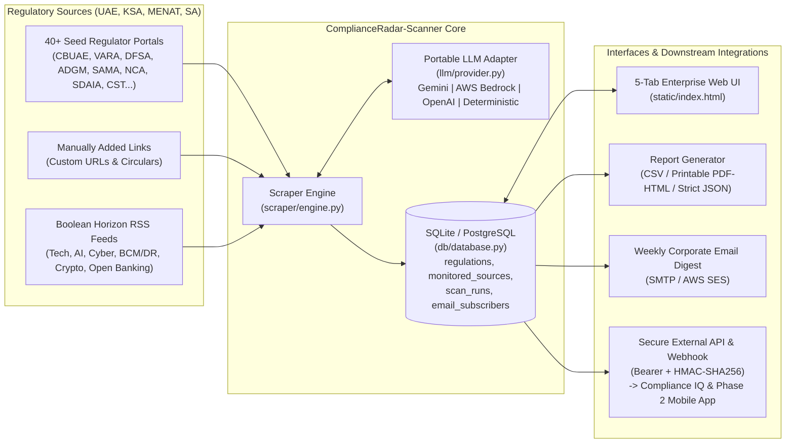

# Architecture & Design — ComplianceRadar-Scanner v2.1

## 1. High-Level Architecture

## 2. Core Modules
- **`config/jurisdictions.yaml`**: Declarative taxonomy for Regions (`MENAT`, `GCC`, `Levant & North Africa`, `Sub-Saharan Africa`), Sectors, Regulation/Standard types, and per-country seed authorities and boolean queries (with `UAE` and `KSA` enabled by default).
- **`llm/provider.py`**: Implements `BaseLLMAdapter` with `BedrockLLMAdapter` (`boto3` `converse` API), `GeminiLLMAdapter`, `OpenAICompatibleAdapter`, and `DeterministicRuleExtractor`.
- **`scraper/engine.py`**: Implements `RegulatoryScannerEngine` for scoped scanning (`run_scan`), single-URL scraping (`scrape_single_source_url`), report generation (`generate_csv_report`, `generate_executive_html_report`), and weekly corporate email dispatch (`send_weekly_corporate_digest`).
- **`db/database.py`**: Persistence layer managing `regulations`, `monitored_sources`, `scan_runs`, `discovered_authorities`, `email_subscribers`, and `email_digest_logs`.
- **`app.py`**: FastAPI application exposing REST endpoints, background scheduler loop, and HMAC-SHA256 authentication.
